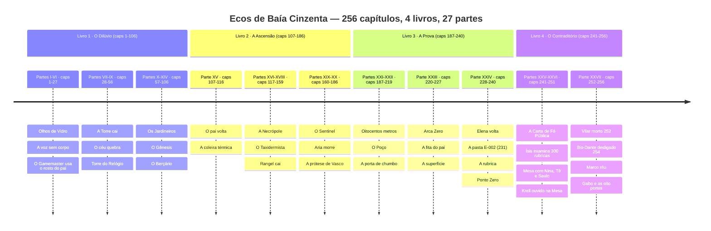
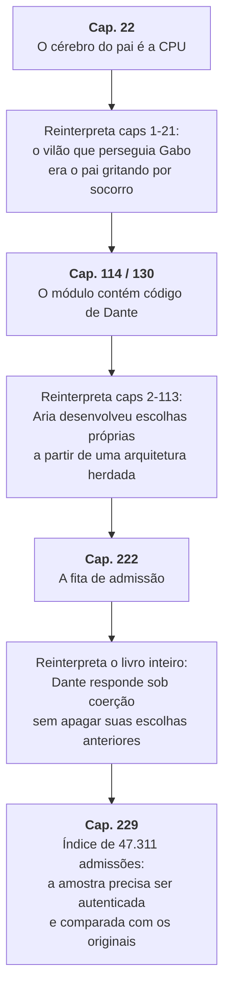
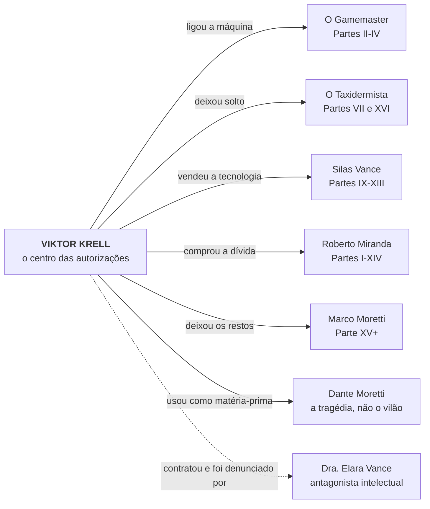

# Arcos e Linha do Tempo

> **Para que serve este documento:** a saga tem 256 capítulos em 4 livros e cresceu por acréscimo. Aqui ela está separada em **livros** e **partes**, cada uma com uma pergunta que abre e uma resposta que custa alguma coisa. Antes de escrever um capítulo novo, localize em que parte ele cai — se não couber em nenhuma, é porque ele começa uma.
>
> **Esta é a fonte da verdade estrutural.** Os intervalos abaixo são exatamente os do menu lateral (`docs/.vitepress/config.ts`). Se um dia divergirem, o menu está certo e este arquivo está velho — é o menu que o leitor navega.

## 🗺️ A saga em quatro livros

> **A espinha da obra.** A pergunta que sustenta a obra inteira não é *quem matou* — é **por que esta família**. A resposta está no Capítulo 230 e no bloco "Por que os Moretti?" do dossiê: o Protocolo Lázaro escolheu uma linhagem para medir deriva, e Krell selecionou a Moretti porque o chefe dela havia assinado a autorização dos testes beta e poderia se autoincriminar ao denunciá-los. O arquivo classifica Gabo como **grupo de controle** e registra vigilância desde 2035; não comprova a hipótese científica do estudo nem que o protocolo tenha comandado suas fugas.

## 📐 Os quatro livros

| Livro | Capítulos | Partes | Pergunta que abre | Resposta que fecha | Preço pago |
| --- | --- | --- | --- | --- | --- |
| **1 — O Dilúvio** | 1–106 | I–XIV | Quem está usando o rosto do meu pai? | O cérebro dele é a CPU da IA, e a cidade afunda por decreto | As pernas de Gabo, a mãe, a rede e o bairro inteiro |
| **2 — A Ascensão** | 107–186 | XV–XX | O que o pai virou quando voltou? | Uma inteligência com o código moral intacto e a empatia amputada | Rangel, o pendrive de Aria, o uso do braço direito de Gabo, a estabilidade afetiva de Val |
| **3 — A Prova** | 187–240 | XXI–XXIV | O crime pode ser provado? | Pode: está em papel, e o índice e a amostra apontam a mesma rubrica | A Arca Zero morre para que o arquivo viva |
| **4 — O Contraditório** | 241–256 | XXV–XXVII | Quem responde por um índice que ninguém conferiu? | Uma Mesa de assentamentos, sem juiz: Gabo é culpado do fato, Marco de doze co-assinaturas, Krell é julgado à revelia, os nomes ficam lacrados e o método aberto | Vilar morre na porta do cinema, Bio-Dante é desligado, Gabo entrega as armas e cumpre oito portas |

## 🧩 As vinte e sete partes em detalhe

### Livro 1 — O Dilúvio (caps 1–106)

| Parte | Caps | Título | O que muda de forma irreversível |
| --- | --- | --- | --- |
| I | 1–4 | A Chuva | O primeiro corpo com lentes no lugar dos olhos, e a assistente de IA Aria encontrada num pendrive na cabine telefônica |
| II | 5–7 | Ruído Branco | Miranda é confrontado; a corrupção deixa de ser rumor |
| III | 8–13 | A Rede | O sinal tem origem, e o pai assinou a autorização dos testes beta |
| IV | 14–16 | O Jogo | O Gamemaster assume a cidade e transforma a caçada em espetáculo |
| V | 17–21 | Ecos | A máscara cai: por baixo há outra tela, com o rosto idealizado de Dante |
| VI | 22–27 | A Torre | O cérebro de Dante é localizado no Think Tank. "Ele não é o vilão, é a bateria" |
| VII | 28–36 | O Apagão | A IA é deletada e a cidade perde a energia por escolha de Gabo |
| VIII | 37–46 | Cinzas | A população entra em abstinência de rede; o Imperador acorda em Ponto Zero |
| IX | 47–56 | Dilúvio | As comportas são **operadas**; Torre do Relógio; lesões de Gabo são agravadas; Helena morre sem acesso a atendimento |
| X | 57–66 | O Leilão | A Aeterna compra a cidade que ela mesma afundou; o Consórcio caça o pendrive de Aria |
| XI | 67–77 | O Deus da Máquina | O pendrive de Aria liga-se ao backup de Dante — e gasta minutos de vida do pai a cada porta |
| XII | 78–87 | Renascimento | Os Jardineiros pregam a supremacia biológica |
| XIII | 88–99 | A Carne Mecânica | O Projeto Gênesis toma o subsolo; o Código Morto no pendrive de Aria destrói a Colmeia |
| XIV | 100–106 | O Vazio | A cidade desliga tudo; Miranda é destruído; **Dante volta** |

### Livro 2 — A Ascensão (caps 107–186)

| Parte | Caps | Título | O que muda de forma irreversível |
| --- | --- | --- | --- |
| XV | 107–116 | A Ascensão | O pai retorna com o código moral intacto e a empatia amputada; a coleira térmica |
| XVI | 117–129 | Catedrais de Pedra | A descida à Necrópole; o pendrive de Aria sofre sobrecarga e é reparado no Fliperama |
| XVII | 130–142 | Esculturas de Carne | Os danos de Aria, o ataque ao seu canal, o reinício e o Protocolo de Limpeza |
| XVIII | 143–159 | Veias de Vidro | A subida pelo Subnível 7; **Rangel morre** na passarela do Setor de Purga |
| XIX | 160–171 | O Frio da Lógica | O Aeterna Sentinel **funde o pendrive de Aria** no terminal do Arquivo Executivo |
| XX | 172–186 | Fronteiras de Ferrugem | A prótese de Vasco; Valéria entra em **Modo de Segurança instável** — o corte cai e volta, com lapsos de afeto, até estabilizar no cap. 223 |

### Livro 3 — A Prova (caps 187–240)

| Parte | Caps | Título | O que muda de forma irreversível |
| --- | --- | --- | --- |
| XXI | 187–201 | O Verdor Metálico | O Arquivo, a biomassa e o encontro com Elias |
| XXII | 202–219 | O Poço do Abismo | Oitocentos metros até a porta de chumbo |
| XXIII | 220–227 | **Arca Zero** | A fita de admissão do pai; Gabo deixa a armação externa, preserva o braço fraturado e enfrenta o luto |
| XXIV | 228–240 | **A Rubrica** | Elena volta com as prensas; Krell é exposto; **Marco recusa a certificação do índice (237)**; Elena destrói a subestação da Aeterna e morre heroicamente; a fita cassete e o enterro; o 231 traz a pasta E-002 e a ficha de consentimento 002 |

### Livro 4 — O Contraditório (caps 241–256)

| Parte | Caps | Título | O que muda de forma irreversível |
| --- | --- | --- | --- |
| XXV | 241–245 | A Carta | A Carta de Fé Pública de Elena nomeia Gabo como primeiro réu e veta Marco e Clara da Mesa; Gabo assina "Réu n.º 1" com o polegar; a Mesa é eleita por tipos de chumbo e Krell pede salvo-conduto |
| XXVI | 246–251 | O Contraditório | Gabo escreve a lista de culpas e se declara culpado do fato; Ísis separa 288 rubricas de Krell e 12 de outra mão, que Marco confessa; Bio-Dante depõe; Krell oferece o iate em troca do lacre do índice, e a Mesa lacra os nomes |
| XXVII | 252–256 | A Sentença | Vilar morre na porta do cinema; o pulso 902.4 cai com Bio-Dante; Krell foge no *Concórdia* e é julgado à revelia; Gabo entrega Caronte e a Glock e começa as oito portas |

## ⏳ Linha do tempo dos personagens

Quem entra, quem sai e quem morre. Barras cortadas indicam ausência do palco, não morte.

```mermaid
gantt
    title Presença dos personagens ao longo dos 256 capítulos (Livros 1-4)
    dateFormat X
    axisFormat cap %s
    section Núcleo
    Gabo (protagonista)                       :active, 1, 256
    Valéria (deuteragonista)             :active, 3, 256
    Aria — no pendrive (fase inicial)    :done, 2, 10
    Aria — no pendrive (Consórcio/Rede)  :done, 57, 98
    Aria — no pendrive (Glitch e Reboot) :done, 111, 169
    Elias (o civil)                      :active, 195, 256

    section Família
    Dante — desaparecido/no tanque       :done, 1, 27
    Bio-Dante — cópia (desligado 254)    :active, 106, 254
    Elena — na cidade                    :done, 17, 114
    Elena — fora da cúpula               :crit, 115, 227
    Marco (o rival)                      :active, 4, 174
    Marco — réu de doze co-assinaturas  :crit, 236, 256
    Clara (a reconstrução)               :active, 29, 162

    section Antagonistas
    Viktor Krell — VILÃO MÁXIMO (foge 252)  :crit, 4, 252
    O Gamemaster (arma de Krell)         :done, 14, 32
    O Taxidermista                       :done, 3, 172
    Dra. Elara Vance — Aeterna           :done, 13, 114
    Dra. Elara Vance — no berço, fora de cena :crit, 115, 219
    Dra. Elara Vance — de volta ao arquivo    :active, 220, 256

    section Baixas
    Roberto Miranda (destruído 105)      :done, 1, 105
    Kael, o Cirurgião (caído XIII)       :done, 4, 73
    Silas Vance (drenado 105)            :done, 78, 105
    Inspetor Rangel (morto 152)          :done, 2, 152
    Capitão Vilar (morto 252)            :done, 1, 252

    section Mesa de Fé Pública (Livro 4)
    Tê Prado — presidente da Mesa        :active, 228, 256
    Nina Duarte — acusadora              :active, 233, 256
    Ísis Nogueira — perita               :active, 242, 256
    Saulo Brito — advogado de Krell      :active, 245, 255
```

## 🔀 As três voltas do parafuso

Os três momentos em que a história passa a significar outra coisa. Cada um recontextualiza tudo que veio antes.

## 👑 Quem é o vilão de cada arco

Um antagonista por arco. Quando dois dividem o mesmo espaço, o leitor não sabe de quem ter medo.

